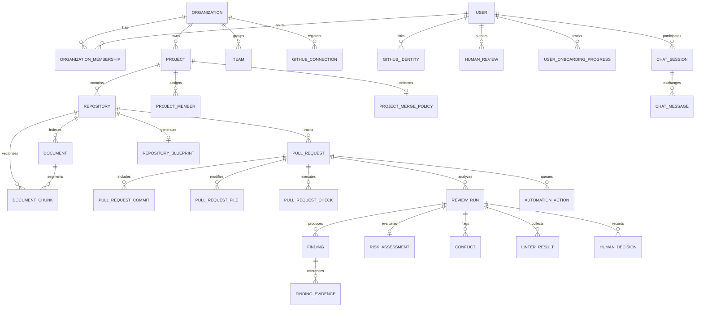
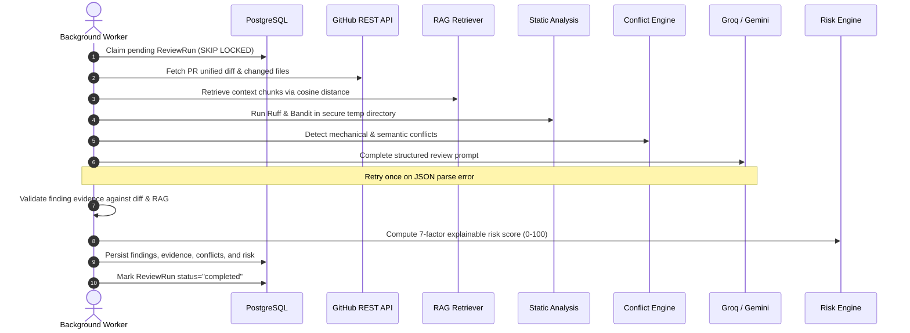
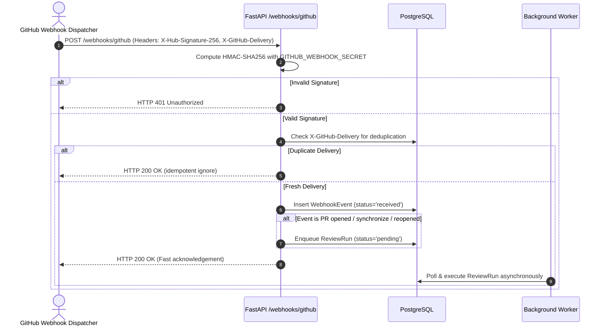

# RepoMind Intelligence — Current System Architecture

**Document Version:** 2.0-Audit  
**Status:** Grounded in Existing Codebase  
**Target:** RepoMind Intelligence 2.0  

---

## 1. High-Level System Architecture

RepoMind employs a **Modular Monolith** architecture with a completely decoupled database-polling background worker and a React 18 single-page application.

```mermaid
graph TB
    subgraph "Client Tier (Browser)"
        SPA["React 18 SPA (Vite + Tailwind)"]
        AUTH_STORE["Session State (HttpOnly Cookie)"]
        RQ["React Query Cache"]
    end

    subgraph "API & Ingestion Tier (FastAPI :8000)"
        ROUTERS["FastAPI Subsystem Routers"]
        AUTH_MW["RBAC Middleware & Permissions"]
        RATE_LIMIT["SlowAPI Limiter (100/min)"]
        WEBHOOK_EP["/webhooks/github (HMAC-SHA256)"]
    end

    subgraph "Background Worker Tier (worker.py)"
        POLL_LOOP["Worker Polling Loop (SKIP LOCKED)"]
        LEASE_MGR["Lease Manager & Stale Recovery"]
        LINTER_RUNNER["Static Analysis (Ruff + Bandit)"]
        CONFLICT_DET["Conflict Engine"]
        RISK_ENG["Risk Calculation Engine"]
    end

    subgraph "Persistence Tier (PostgreSQL + pgvector :5432)"
        PG_REL["Relational Tables (39 tables)"]
        PG_VEC["DocumentChunk pgvector (384-dim)"]
        ALEMBIC["Alembic Migrations (Head: 5e34700732dc)"]
    end

    subgraph "Intelligence & External Tier"
        GROQ["Groq LLM (Primary)"]
        GEMINI["Gemini LLM (Fallback)"]
        LOCAL_EMB["SentenceTransformers (all-MiniLM-L6-v2)"]
        GH_API["GitHub REST API v3"]
    end

    SPA -->|REST API Requests / HttpOnly Cookies| ROUTERS
    WEBHOOK_EP -->|HMAC-SHA256 Delivery| ROUTERS
    ROUTERS --> AUTH_MW
    ROUTERS --> RATE_LIMIT
    ROUTERS -->|CRUD & Job Enqueueing| PG_REL
    
    POLL_LOOP -->|SELECT FOR UPDATE SKIP LOCKED| PG_REL
    POLL_LOOP --> LINTER_RUNNER
    POLL_LOOP --> CONFLICT_DET
    POLL_LOOP --> RISK_ENG
    
    POLL_LOOP -->|Diff & PR Files| GH_API
    ROUTERS -->|Git Tree Fetch| GH_API
    
    POLL_LOOP -->|Embedding & Inference| LOCAL_EMB
    POLL_LOOP -->|Vector Similarity Search| PG_VEC
    POLL_LOOP -->|Structured Review Prompt| GROQ
    GROQ -.->|Transient Failover| GEMINI
```



---

## 2. Technology Stack Specifications

| Layer | Component | Version / Specification | Purpose |
|-------|-----------|-------------------------|---------|
| **Frontend** | React | 18.2.0 | Reactive component UI library |
| | Vite | 5.2.0 | High-performance build tool & dev server |
| | React Router DOM | 7.18.3 | Client-side routing with role-gated routes |
| | React Query | 5.102.8 | Asynchronous server-state synchronization |
| | Mermaid.js | 12.3.0 | Client-side dynamic architecture diagramming |
| | React Diff Viewer | 4.4.0 | Side-by-side and unified git diff visualization |
| | Tailwind CSS | 3.4.0 | Utility-first design token styling |
| **Backend** | FastAPI | 0.115.0 | Async web framework for OpenAPI endpoints |
| | Uvicorn | 0.30.0 | ASGI web server |
| | Pydantic | >=2.12.5 | V2 data validation and schema serialization |
| | Pydantic Settings | >=2.0.0 | Environment-driven configuration management |
| | SlowAPI | >=0.1.9 | IP-based request rate limiting |
| | PyJWT | 2.9.0 | JWT generation and HMAC signature verification |
| | Passlib (bcrypt) | 1.7.4 | Salted password hashing for local user accounts |
| | Cryptography (Fernet) | >=42.0.0 | Symmetric encryption for stored GitHub tokens |
| **Database** | PostgreSQL | 16.x | Enterprise relational ACID persistence |
| | pgvector | >=0.5.0 | Native vector extension for cosine distance search |
| | SQLAlchemy | 2.0.35 | Relational ORM and connection pooling |
| | Alembic | 1.13.2 | Database schema migration engine |
| **AI / ML** | Sentence-Transformers | 6.0.1 | Local text embedding generation |
| | Embedder Model | all-MiniLM-L6-v2 | 384-dimensional dense semantic vectors |
| | Groq SDK | >=0.5.0 | High-speed LLM inference (Default: gpt-oss-120b) |
| | Google GenAI SDK | google-genai | Multimodal LLM inference (Default: gemini-3.5-flash-lite) |
| **Static Analysis**| Ruff | 0.16.7 | Extreme-speed Python linter |
| | Bandit | 1.9.4 | Python AST security vulnerability scanner |

---

## 3. Database Entity Relationship Model

RepoMind enforces a strict hierarchical multi-tenant structure:
`Organization` -> `Project` -> `Repository` -> `PullRequest` -> `ReviewRun`.



### Key Foreign Key Invariants & Cascades
- **Organization Deletion:** Cascades down to delete all associated Projects, Repositories, Memberships, Teams, and Webhook Events.
- **Repository Deletion:** Cascades down to delete all indexed Documents, pgvector Chunks, Blueprints, PRs, and ReviewRuns.
- **Pull Request Deletion:** Cascades down to delete all Commits, Changed Files, ReviewRuns, Risk Assessments, and Findings.
- **User Deletion:** Cleans up memberships, private progress, and identities; nullifies author pointers on PRs and audit logs (`ON DELETE SET NULL`) to preserve institutional history.

---

## 4. API Communication & Security Architecture

### 4.1 Authentication & Session Handling
- Authentication is initiated via `POST /auth/login` or `POST /auth/bootstrap`.
- Sessions are maintained using a **JWT transmitted via HttpOnly cookie** (`access_token`).
- Cookie flags are automatically configured based on `ENVIRONMENT`:
  - `HttpOnly`: Enforced across all environments (prevents XSS token exfiltration).
  - `SameSite`: Configured to `lax` by default.
  - `Secure`: Dynamically toggled `True` in production/staging environments, `False` in local HTTP development.
- The React SPA client includes `credentials: 'include'` on all `fetch()` requests through `apiRequest` in [frontend/src/lib/api.js](file:///d:/Repomind/Repo-Mind-/frontend/src/lib/api.js).

### 4.2 Role-Based Access Control (RBAC)
RBAC is strictly enforced **server-side**. Frontend conditional rendering only enhances UX; it is never relied upon for security.

```
       [Developer]
            │
            ▼
        [Reviewer]
            │
            ▼
       [Team Lead]
            │
            ▼
       [Org Admin]
```

- **Developer:** Read organizations, projects, repos, PRs, findings, reviews, analytics, run reviews, submit feedback, chat.
- **Reviewer:** All Developer permissions + Submit reviews (`PRS_REVIEW`), Request changes (`PRS_REQUEST_CHANGES`), Dismiss findings (`FINDINGS_DISMISS`), Triage security issues (`SECURITY_REVIEW`).
- **Team Lead:** All Reviewer permissions + Approve PRs (`PRS_APPROVE`), Queue merges (`PRS_MERGE`), Trigger repository re-indexing (`REPOS_INDEX`).
- **Org Admin:** All Team Lead permissions + Update organization (`ORG_UPDATE`), Manage projects (`PROJECTS_CREATE/UPDATE/DELETE`), Manage members (`MEMBERS_INVITE/UPDATE/REMOVE`), Connect/Delete repositories (`REPOS_CONNECT/UPDATE/DELETE`), Update merge policies (`POLICIES_UPDATE`), View audit logs (`AUDIT_READ`).

---

## 5. Existing AI Pipeline & Review Execution

The AI review process operates as an end-to-end pipeline executed inside `run_review()` in [backend/app/review/service.py](file:///d:/Repomind/Repo-Mind-/backend/app/review/service.py):



### Structural Security Invariants
1. **DB-Authoritative Scoping:** `repository_id` is always derived from `PullRequest.repository_id` in the database, never from client parameters.
2. **Token Seclusion:** GitHub PATs are decrypted in-process for the GitHub API call and are never passed to the LLM.
3. **Prompt Injection Defense:** Diffs, RAG chunks, and linter outputs are passed strictly as `user_content` and never interpolated into the `system_prompt`.

---

## 6. Repository Indexing & Vector Search Workflow

Repository indexing ingests repository files into `document` and `document_chunk` tables to support Code-Aware RAG.

```mermaid
flowchart TD
    START([Trigger Indexing]) --> RESOLVE[Resolve Repository & Decrypt PAT]
    RESOLVE --> TREE[Fetch Git Tree recursively from GitHub]
    TREE --> FILTER[Apply Security Filter: Exclude node_modules, .env, binaries]
    FILTER --> HASH[Compute SHA256 Content Hash]
    HASH --> IDEMP{Content Hash matches existing DB document?}
    IDEMP -- Yes --> SKIP[Skip re-embedding]
    IDEMP -- No --> STORE_DOC[Upsert Document Record]
    STORE_DOC --> CHUNK[Split into 50-line chunks with 10-line overlap]
    CHUNK --> CLASSIFY[Categorize chunk_type: documentation | test_code | source_code]
    CLASSIFY --> EMBED[Generate 384-dim embeddings via all-MiniLM-L6-v2]
    EMBED --> STORE_CHUNK[Insert into document_chunk with pgvector]
    STORE_CHUNK --> FINISH([Update index_status='indexed'])
```

---

## 7. GitHub Webhook Ingestion Workflow

Webhooks allow RepoMind to react in near real-time to repository activity.



---

## 8. Background Processing & Worker Lease Architecture

RepoMind avoids Redis and Celery dependencies by utilizing PostgreSQL for job scheduling:
- **Atomicity:** `SELECT * FROM review_run WHERE status='pending' ORDER BY id ASC FOR UPDATE SKIP LOCKED LIMIT 1`.
- **Fencing:** Every job claim generates a cryptographically random `claim_token`. The worker validates this token on every heartbeat and prior to committing results. If a job has been superseded by a newer PR commit or reclaimed due to lease timeout (>300s), the worker aborts without corrupting state.
- **Crash Recovery:** If a worker crashes while processing, `recover_stale_running_jobs()` checks whether the running job exceeded the lease timeout:
  - If retry count < 3, increments retry count and sets status back to `pending`.
  - If retry count >= 3, transitions status to `failed` with an observable audit message.
  - If the PR's `head_sha` has advanced, transitions status to `superseded`.
