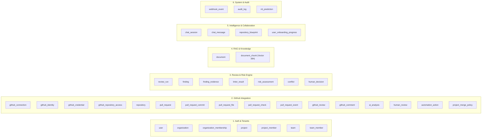

# RepoMind Intelligence 2.0 — Complete Database Audit

**Document Version:** 2.0-Audit  
**Database Engine:** PostgreSQL 16 with native `pgvector`  
**ORM:** SQLAlchemy 2.0.35  
**Migration Tool:** Alembic 1.13.2  
**Target Migration Head:** `5e34700732dc_add_claim_token_to_review_run` (27 revisions)  
**Strict Directives Observed:** Database inspected only. No tables altered, created, or dropped.

---

## 1. Complete Database Schema Inventory

The RepoMind application architecture encompasses **39 distinct tables** defined across SQLAlchemy models and Alembic migrations.

### 1.1 Domain Table Breakdown

---

## 2. Detailed Table Specifications & Relationships

### 2.1 Domain 1: Authentication & Multi-Tenant Hierarchy

#### `user`
- **PK:** `id` (Integer, autoincrement)
- **Columns:**
  - `email` (String(255), Unique, Not Null, Indexed)
  - `password_hash` (String(255), Nullable — allows pending invited users)
  - `invitation_token_hash` (String(255), Unique, Nullable, Indexed)
  - `invitation_expires_at` (DateTime(timezone=True), Nullable)
  - `created_at` (DateTime(timezone=True), Not Null)
- **Cascades:** Deletes cascade to `organization_membership`, `github_identity`, and `user_onboarding_progress`.

#### `organization`
- **PK:** `id` (Integer, autoincrement)
- **Columns:** `name` (String(255), Not Null), `created_at` (DateTime(timezone=True), Not Null)
- **Cascades:** Deletes cascade to `organization_membership`, `project`, `team`, and `github_connection`.

#### `organization_membership`
- **PK:** `id` (Integer, autoincrement)
- **FKs:** `user_id` -> `user.id` (ON DELETE CASCADE), `organization_id` -> `organization.id` (ON DELETE CASCADE)
- **Columns:** `role` (Enum: `developer`, `reviewer`, `team_lead`, `org_admin`, Not Null, Default `developer`)
- **Indexes:** Indexed on `user_id` and `organization_id`.

#### `project`
- **PK:** `id` (Integer, autoincrement)
- **FKs:** `organization_id` -> `organization.id` (ON DELETE CASCADE, Indexed)
- **Columns:** `name` (String(255), Not Null)
- **Cascades:** Deletes cascade to `repository`, `project_member`, and `project_merge_policy`.

#### `project_member`
- **PK:** `id` (Integer, autoincrement)
- **FKs:** `user_id` -> `user.id` (CASCADE), `project_id` -> `project.id` (CASCADE)
- **Columns:** `role` (Enum: `developer`, `reviewer`, `team_lead`, `org_admin`)

#### `team` & `team_member`
- Grouping construct within an Organization.
- `team`: `id`, `organization_id` (FK CASCADE), `name` (String(255)).
- `team_member`: `id`, `team_id` (FK CASCADE), `user_id` (FK CASCADE).

---

### 2.2 Domain 2: GitHub Integration & Pull Requests

#### `github_connection`
- **PK:** `id` (Integer, autoincrement)
- **FKs:** `organization_id` -> `organization.id` (ON DELETE CASCADE, Indexed)
- **Columns:** `encrypted_token` (String(1024), Fernet encrypted), `scope` (String(255)), `created_at` (DateTime).

#### `github_identity` & `github_credential`
- Per-user OAuth account linkage.
- `github_identity`: `user_id` (FK `user.id`, Unique), `github_user_id` (String(255), Unique), `github_login`, `connection_status`, `verified_at`.
- `github_credential`: `github_identity_id` (FK CASCADE, Unique), `encrypted_access_token` (String(1024), Fernet), `encrypted_refresh_token` (String(1024)), `expires_at`.

#### `repository`
- **PK:** `id` (Integer, autoincrement)
- **FKs:** `project_id` -> `project.id` (ON DELETE CASCADE, Indexed)
- **Columns:**
  - `provider` (String(50), Default "github")
  - `github_repository_id` (String(255), Unique, Indexed)
  - `github_owner` (String(255), Not Null)
  - `github_name` (String(255), Not Null)
  - `github_url` (String(1024), Nullable)
  - `default_branch` (String(255), Default "main")
  - `index_status` (String(50), Default "unindexed")
  - `last_indexed_at` (DateTime(timezone=True), Nullable)

#### `pull_request`
- **PK:** `id` (Integer, autoincrement)
- **FKs:**
  - `repository_id` -> `repository.id` (ON DELETE CASCADE, Indexed)
  - `author_user_id` -> `user.id` (ON DELETE SET NULL, Nullable)
- **Constraints:** `UniqueConstraint(repository_id, github_number, name="uq_pull_request_repo_number")`
- **Columns:**
  - `github_pr_id` (String(255), Unique, Indexed)
  - `github_number` (Integer, Not Null)
  - `title` (String(512), Not Null)
  - `description` (String, Nullable)
  - `github_author_login` (String(255))
  - `source_branch`, `target_branch`, `base_sha`, `head_sha` (String(255))
  - `additions`, `deletions`, `files_changed` (Integer)
  - `draft_status` (Integer, Default 0)
  - `state` (String(50), Default "open")
  - `mergeable_state` (String(50))
  - `created_at`, `updated_at`, `closed_at`, `merged_at` (DateTime(timezone=True))
  - `merged_by`, `merge_commit_sha` (String(255))
  - `synchronization_status` (String(50), Default "SYNCED")
  - `last_synced_at` (DateTime(timezone=True))

#### PR Detail Subtables
- `pull_request_commit`: `pull_request_id` (FK CASCADE), `sha`, `author`, `message`, `created_at`.
- `pull_request_file`: `pull_request_id` (FK CASCADE), `file_path`, `status`, `additions`, `deletions`, `patch_data`.
- `pull_request_check`: `pull_request_id` (FK CASCADE), `github_check_run_id` (Unique), `name`, `status`, `conclusion`.
- `pull_request_event`: `pull_request_id` (FK CASCADE), `event_type`, `actor_login`, `payload`, `timestamp`.
- `github_review`: `pull_request_id` (FK CASCADE), `github_review_id` (Unique), `state`, `body`.
- `github_comment`: `pull_request_id` (FK CASCADE), `github_comment_id` (Unique), `file_path`, `line_number`, `body`.
- `ai_analysis`: `pull_request_id` (FK CASCADE), `commit_sha` (Indexed), `status`, `findings` (Text/JSON).
- `human_review`: `pull_request_id` (FK CASCADE), `commit_sha` (Indexed), `reviewer_id` (FK `user.id`), `decision`, `comment`, `status`.
- `automation_action`: Central asynchronous queue for GitHub actions (`MERGE`, `APPROVE`, `REQUEST_CHANGES`). Idempotency key uniqueness enforced.
- `project_merge_policy`: Rules per project (`require_human_approval`, `required_approvals`, `require_ai_analysis`, `require_ci_success`, `auto_merge_enabled`).

---

### 2.3 Domain 3: Review & Risk Engine

#### `review_run`
- **PK:** `id` (Integer, autoincrement)
- **FKs:** `pull_request_id` -> `pull_request.id` (ON DELETE CASCADE, Indexed)
- **Columns:**
  - `commit_sha` (String(255), Nullable)
  - `status` (String(50), Not Null, Default "pending" — `pending`, `running`, `completed`, `failed`, `superseded`)
  - `repomind_version`, `prompt_version`, `llm_model` (String)
  - `rag_enabled` (Boolean, Default True)
  - `intelligence_mode` (String(20), Default "v1")
  - `started_at`, `completed_at`, `heartbeat_at` (DateTime(timezone=True))
  - `retry_count` (Integer, Default 0)
  - `claim_token` (String(64), Nullable — worker fencing token)
  - `progress_message` (String(255), Nullable)
  - `error_message` (Text, Nullable)

#### `finding`
- **PK:** `id` (Integer, autoincrement)
- **FKs:** `review_run_id` -> `review_run.id` (ON DELETE CASCADE, Indexed)
- **Columns:**
  - `type` (String(100), Not Null — category: correctness, security, performance, maintainability, etc.)
  - `severity` (String(50), Not Null — critical, high, medium, low, info)
  - `file` (String(1024), Nullable), `line` (Integer, Nullable)
  - `title` (String(512), Not Null), `explanation` (Text, Not Null)
  - `rule_source` (Text, Nullable), `recommendation` (Text, Nullable)
  - `confidence` (Float, Not Null)
  - `status` (String(50), Not Null, Default "open" — `open`, `accepted`, `rejected`, `resolved`, `dismissed`)
  - `evidence_status` (String(50), Default "unverified" — `supported`, `unverified`, `contradicted`)
  - `lifecycle_status` (String(50), Default "new" — `new`, `persistent`, `resolved`)

#### `finding_evidence`
- Grounded citations backing findings.
- **FKs:** `finding_id` -> `finding.id` (ON DELETE CASCADE, Indexed)
- **Columns:** `evidence_status`, `source_type` (documentation, source_code, linter, diff, test), `source_path`, `source_text`, `citation_metadata` (JSONB).

#### `risk_assessment`
- Explainable risk calculation for a PR review run.
- **FKs:** `review_run_id` -> `review_run.id` (ON DELETE CASCADE, Unique, Indexed)
- **Columns:**
  - `score` (Integer, 0-100, Default 0)
  - `level` (String(20), Default "low" — `low`, `medium`, `high`, `critical`)
  - `factors` (JSONB — weighted breakdown across 7 categories)
  - `blast_radius` (JSONB — affected modules, files, tests)
  - `test_impact` (JSONB — impacted test files, missing tests)
  - `summary` (Text)
  - `calculated_at` (DateTime(timezone=True))

#### `conflict`
- Semantic and mechanical conflict detections.
- **FKs:** `review_run_id` -> `review_run.id` (ON DELETE CASCADE, Indexed)
- **Columns:** `conflict_type` (mechanical | semantic), `category` (architecture, api_contract, data_model, security_policy, etc.), `severity`, `title`, `description`, `evidence` (JSONB), `status`.

#### `linter_result`
- Raw static analysis output.
- **FKs:** `review_run_id` -> `review_run.id` (ON DELETE CASCADE, Indexed)
- **Columns:** `tool` (String(255)), `raw_output` (JSONB).

#### `human_decision`
- Audit trail for human review gate.
- **FKs:** `review_run_id` -> `review_run.id` (CASCADE), `user_id` -> `user.id` (SET NULL)
- **Columns:** `action` (approve | request_changes | dismiss | resolve_finding), `target_type`, `target_id`, `note`, `created_at`.

---

### 2.4 Domain 4: Code-Aware RAG & pgvector Storage

#### `document`
- Tracked indexed files from a repository.
- **FKs:** `repository_id` -> `repository.id` (ON DELETE CASCADE, Indexed)
- **Columns:** `path` (String, Indexed), `content_hash` (String, SHA256), `updated_at` (DateTime).

#### `document_chunk`
- Vectorized text fragments for cosine distance search.
- **FKs:**
  - `document_id` -> `document.id` (ON DELETE CASCADE, Indexed)
  - `repository_id` -> `repository.id` (ON DELETE CASCADE, Indexed)
- **Columns:**
  - `text` (Text, Not Null)
  - `embedding` (`Vector(384)`, Not Null)
  - `chunk_index` (Integer, Not Null)
  - `chunk_type` (String(50), Default "documentation", Indexed — `documentation`, `source_code`, `test_code`)
  - `file_path` (String(1024), Nullable, Indexed)

---

### 2.5 Domain 5: Collaboration & Developer Onboarding

#### `chat_session` & `chat_message`
- Context-bounded conversational assistant.
- `chat_session`: `user_id` (FK `user.id`), `organization_id` (FK `organization.id`), `context_type` (pr | repository | review), `context_id` (Integer), `created_at`, `last_message_at`.
- `chat_message`: `session_id` (FK CASCADE), `role` (user | assistant), `content` (Text), `sources` (JSONB), `is_grounded` (Boolean), `created_at`.

#### `repository_blueprint`
- Cached architectural mental model generated per repository commit snapshot.
- **FKs:** `repository_id` -> `repository.id` (ON DELETE CASCADE, Unique, Indexed)
- **Columns:**
  - `analyzed_commit_sha` (String(40), Not Null, Indexed)
  - `status` (String(20), Default "pending", Indexed — `pending`, `ready`, `failed`)
  - `retry_count`, `generation_started_at`, `generation_completed_at`, `generation_error`
  - `summary` (Text), `architecture_pattern` (String(100))
  - `subsystems` (JSONB — list of `{name, path, purpose, key_files}`)
  - `request_flow` (JSONB — list of `{step_number, layer, file, symbol, description}`)
  - `tracks` (JSONB — role plans for `backend`, `frontend`, `fullstack` with reading orders & milestones)
  - `caution_zones` (JSONB — high-risk blast radius directories)
  - `safe_starter_areas` (JSONB — entry points and starter ideas)
  - `mermaid_diagram` (Text — generated Mermaid flowchart)

#### `user_onboarding_progress`
- Private developer milestone checklist.
- **FKs:** `user_id` -> `user.id` (CASCADE), `repository_id` -> `repository.id` (CASCADE)
- **Constraints:** `UniqueConstraint(user_id, repository_id, name="uq_user_repo_onboarding")`
- **Columns:** `active_track` (String(50), Default "backend"), `completed_milestones` (JSONB), `notes` (Text — private scratchpad).

---

### 2.6 Domain 6: Webhooks, Audit & ML

#### `webhook_event`
- Ingested GitHub webhook payloads.
- **FKs:** `repository_id` -> `repository.id` (ON DELETE SET NULL, Indexed)
- **Constraints:** `UniqueConstraint(github_delivery_id, name="uq_webhook_event_github_delivery_id")`
- **Columns:** `github_delivery_id` (String(255), Unique, Indexed), `event_type` (String(100)), `action` (String(100)), `payload` (JSONB), `status` (received | processed | skipped | failed), `error_message`, `received_at`, `processed_at`.

#### `audit_log`
- Administrative event ledger.
- **FKs:** `user_id` -> `user.id` (ON DELETE SET NULL, Indexed)
- **Columns:** `action` (String(255)), `target_type` (String(255)), `target_id` (Integer), `created_at` (DateTime(timezone=True)).

#### `ml_prediction`
- Machine learning review delay prediction (created in migration `5a5ce4894f5c`).
- **FKs:** `pull_request_id` -> `pull_request.id` (ON DELETE CASCADE, Unique, Indexed)
- **Columns:** `predicted_delay_category` (String(50)), `confidence_score` (Float), `prediction_model_version` (String(50)), `created_at` (DateTime(timezone=True)).

---

## 3. Complete Alembic Migration Chain (27 Revisions)

The Alembic migration directory (`backend/alembic/versions`) contains a verified, linear, 27-step revision chain:

| Step | Revision ID | Down Revision | Description / Schema Impact |
|------|-------------|---------------|-----------------------------|
| 1 | `9582111491ee` | `<base>` | Initial auth tables (`user`, `organization`, `organization_membership`) |
| 2 | `e3a7f2d63e43` | `9582111491ee` | Add `project` and `repository` tables |
| 3 | `86c411915709` | `e3a7f2d63e43` | Update role enum to 4 roles (`developer`, `reviewer`, `team_lead`, `org_admin`) |
| 4 | `b334a8c323d8` | `86c411915709` | Fix role enum casing |
| 5 | `cab03f32deec` | `b334a8c323d8` | Add `audit_log` table |
| 6 | `09cc8a4080e0` | `cab03f32deec` | Fix role values to lowercase |
| 7 | `f52225de5db9` | `09cc8a4080e0` | Add `pull_request` and `commit` tables |
| 8 | `6785debac2a0` | `f52225de5db9` | Add user onboarding fields |
| 9 | `bb220ed50f98` | `6785debac2a0` | Repository indexing temporary JSONB storage |
| 10 | `f2a7b8f58af8` | `bb220ed50f98` | Native pgvector integration; add `document` and `document_chunk` tables |
| 11 | `a1b2c3d4e5f6` | `f2a7b8f58af8` | Phase 8 review models (`review_run`, `finding`, `linter_result`) |
| 12 | `rm20_001` | `a1b2c3d4e5f6` | RepoMind 2.0 schema extension (`risk_assessment`, `conflict`, `finding_evidence`, `human_decision`) |
| 13 | `rm20_002` | `rm20_001` | RAG schema extension: alter embedding dimension to 768 and add chunk metadata |
| 14 | `rm20_003` | `rm20_002` | Add `lifecycle_status` to `finding` table |
| 15 | `5a5ce4894f5c` | `rm20_003` | Add `ml_prediction` table |
| 16 | `9ebe0b6eb803` | `5a5ce4894f5c` | Revert embedding dimension to 384 (`Vector(384)`) for local sentence-transformers model |
| 17 | `476568fc3a70` | `9ebe0b6eb803` | GitHub integration models (`github_identity`, `github_credential`, `automation_action`, etc.) |
| 18 | `cd8a43834a0f` | `476568fc3a70` | Add `team` and `team_member` models |
| 19 | `a29d00a3e5e1` | `cd8a43834a0f` | Sync `webhook_event.action` column |
| 20 | `db0ec7da784d` | `a29d00a3e5e1` | Add missing `webhook_event` columns (`status`, `error_message`, `received_at`) |
| 21 | `2426528e6df4` | `db0ec7da784d` | Add chat assistant models (`chat_session`, `chat_message`) |
| 22 | `71a3ba5afa1e` | `2426528e6df4` | Add `repository_blueprint` and `user_onboarding_progress` tables |
| 23 | `b41c9e8f2a10` | `71a3ba5afa1e` | Add unique constraint on `webhook_event.github_delivery_id` |
| 24 | `364aada3d1eb` | `b41c9e8f2a10` | Add pull request metrics columns (`additions`, `deletions`, `files_changed`) |
| 25 | `f3f9473f10b8` | `364aada3d1eb` | Add review run lease and retry columns (`heartbeat_at`, `retry_count`, `progress_message`) |
| 26 | `5e34700732dc` | `f3f9473f10b8` | Add `claim_token` column to `review_run` (HEAD) |

---

## 4. Database Discrepancies & Audit Findings

### 4.1 Target Database Unmigrated
- **Finding:** Inspection of PostgreSQL confirmed database `repomind` contains only the `alembic_version` table with **0 rows**.
- **Impact:** The backend will throw SQL errors on any table query until `alembic upgrade head` is executed against `repomind`.
- **Note:** In Phase 20, testing was executed on `repomind_db` up to revision `db0ec7da784d`. The active `.env` now targets `repomind`, which is in an unmigrated state.

### 4.2 Missing `vector` Extension in Target Database
- **Finding:** `SELECT extname FROM pg_extension` reveals only `plpgsql` is installed in `repomind`.
- **Impact:** Alembic migration `f2a7b8f58af8` will execute `CREATE EXTENSION IF NOT EXISTS vector;`. PostgreSQL must have the pgvector extension binary available.

### 4.3 Missing ORM Model for `ml_prediction`
- **Finding:** Table `ml_prediction` was created in revision `5a5ce4894f5c`, but no matching class exists in `backend/app/*/models.py`.
- **Recommendation:** If ML review delay prediction is retained for RepoMind Intelligence 2.0, define `class MLPrediction(Base)` in `backend/app/review/models.py`. If deprecated, create a migration to drop it cleanly.

### 4.4 Redundant `WebhookEvent` Declarations
- **Finding:** `WebhookEvent` is declared twice:
  - `backend/app/github/models.py` (columns: `id, repository_id, github_delivery_id, event_type, payload(String), processed, created_at, processed_at`)
  - `backend/app/webhooks/models.py` (columns: `id, github_delivery_id, event_type, action, repository_id, payload(JSONB), status, error_message, received_at, processed_at`)
- **Impact:** Both use `__table_args__ = {"extend_existing": True}`, which prevents startup crashes, but creates semantic ambiguity about which model is authoritative.

### 4.5 Embedder Configuration Discrepancy
- **Finding:** Migration `rm20_002` bumped vector dimensions to 768. Migration `9ebe0b6eb803` reverted dimensions to 384. `backend/app/core/config.py` still specifies `all-mpnet-base-v2` (768-dim), while `embedder.py` uses `all-MiniLM-L6-v2` (384-dim).
- **Recommendation:** Align `config.py` setting `EMBEDDING_MODEL` to `"sentence-transformers/all-MiniLM-L6-v2"` to match the 384-dimensional database schema.
