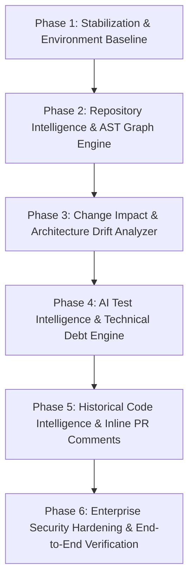

# RepoMind Intelligence 2.0 — Implementation Roadmap

**Document Version:** 2.0-Roadmap  
**Status:** PROPOSED PLAN — PENDING USER APPROVAL  
**Guiding Directives:**
- Reuse existing components, services, and models wherever possible.
- Do NOT rewrite or rebuild from scratch.
- Preserve all existing working functionality.
- Do NOT replace the technology stack (FastAPI, React 18, Vite, PostgreSQL + pgvector, Uvicorn, Tailwind).
- Do NOT modify any code or the database until the user explicitly approves this plan.

---

## 1. Upgrade Strategy & Phasing Overview

The evolution from the current partially developed state to **RepoMind Intelligence 2.0** is organized into **6 sequential, dependency-ordered phases**. Each phase specifies required backend modules, frontend components, database changes, API endpoints, dependencies, and testing requirements.

---

## 2. Phase-by-Phase Implementation Specifications

### Phase 1: Stabilization & Environment Baseline

**Objective:** Resolve immediate runtime defects, migrate target database, align configuration, and fix failing test suites without altering existing functional architecture.

1. **Database Migration to Target Database:**
   - Execute `alembic upgrade head` on the active target database (`repomind`) to bring all 39 tables and the `vector` extension up to revision `5e34700732dc`.
   - Verify table integrity, foreign keys, and unique constraints.
2. **Configuration Synchronization:**
   - Align `backend/app/core/config.py`: Set `EMBEDDING_MODEL = "sentence-transformers/all-MiniLM-L6-v2"` to match the 384-dimensional database schema and `embedder.py`.
3. **Environment & Dependency Resolution:**
   - Install `slowapi>=0.1.9` into the runtime Python environment so backend tests and startup scripts execute cleanly.
4. **Fix Broken Endpoint `/pull-requests/{id}/files`:**
   - Replace the static mock return in `backend/app/github/routes.py` with real database queries against `pull_request_file`.
5. **Fix Vitest Lifecycle Issue in `ReviewUI.test.jsx`:**
   - Update `ReviewPage.jsx` component mount logic or test mock structure so initial review trigger does not consume subsequent click mocks.
- **Testing Requirements:**
  - All 30 Pytest backend modules pass.
  - All 3 Vitest frontend test suites pass.
  - Healthcheck and database connectivity test passes.

---

### Phase 2: Repository Intelligence & AST Graph Engine

**Objective:** Upgrade the repository indexing pipeline from naive line-based text chunking to syntax-aware AST parsing, symbol indexing, and cross-file dependency mapping.

1. **Required Backend Modules:**
   - `backend/app/intelligence/ast_parser.py`: Tree-sitter / standard `ast` parsing for Python, TypeScript/JavaScript to extract classes, functions, interfaces, methods, and docstrings.
   - `backend/app/intelligence/symbol_indexer.py`: Extracts and persists declared symbols and their line ranges.
   - `backend/app/intelligence/dependency_extractor.py`: Parses manifest files (`package.json`, `requirements.txt`, `pyproject.toml`) to construct a structured package dependency catalog.
   - `backend/app/rag/ast_chunker.py`: Syntax-aware chunker that respects function and class boundaries rather than arbitrary line cuts.
2. **Required Frontend Modules:**
   - `frontend/src/pages/RepositoryTopologyPage.jsx`: Interactive component and package dependency visualizer using Mermaid.js or SVG DAG.
   - `frontend/src/components/Intelligence/SymbolSearchModal.jsx`: Quick search for indexed functions and classes.
3. **Database Changes (Alembic Revision):**
   - Create table `code_symbol`:
     - `id` (PK, Integer)
     - `repository_id` (FK `repository.id`, CASCADE, Indexed)
     - `file_path` (String(1024), Indexed)
     - `name` (String(255), Indexed)
     - `symbol_type` (String(50) — `function`, `class`, `method`, `interface`)
     - `start_line` (Integer), `end_line` (Integer)
     - `docstring` (Text, Nullable)
     - `signature` (String(1024))
   - Create table `package_dependency`:
     - `id` (PK, Integer)
     - `repository_id` (FK `repository.id`, CASCADE, Indexed)
     - `ecosystem` (String(50) — `npm`, `pypi`, `cargo`)
     - `package_name` (String(255), Indexed)
     - `version_spec` (String(100))
4. **API Endpoints:**
   - `GET /repositories/{id}/symbols` (Search symbols by name/type)
   - `GET /repositories/{id}/dependencies` (List extracted dependencies)
   - `GET /repositories/{id}/topology` (Return component interaction graph)
5. **Dependencies:** `tree-sitter` (optional/lightweight fallback via Python built-in `ast` + regex for JS/TS).
6. **Testing Requirements:**
   - Unit tests for AST parser across Python and JS/TS snippets.
   - Verification that vector embeddings for syntax-aware chunks yield higher retrieval precision.

---

### Phase 3: Change Impact & Architecture Drift Analyzer

**Objective:** Enable deep impact analysis for PRs, detecting breaking contract changes, downstream caller ripple effects, and architectural boundary violations.

1. **Required Backend Modules:**
   - `backend/app/impact/engine.py`: Computes symbol-level call graphs to determine what outside code calls modified symbols.
   - `backend/app/impact/api_contract.py`: Detects changes to public API schemas (e.g., modified route arguments, response models).
   - `backend/app/impact/db_migration.py`: Inspects Alembic migration scripts in PR diffs for destructive operations (table drop, column drop, lock-heavy alterations).
   - `backend/app/architecture/rules.py`: Evaluates PR import graphs against defined architectural boundaries (e.g., prohibiting database imports inside presentation layers).
2. **Required Frontend Modules:**
   - `frontend/src/pages/ChangeImpactPage.jsx`: Visual representation of downstream ripple effects and impacted endpoints.
   - `frontend/src/components/Impact/BlastRadiusViewer.jsx`: Interactive graph of directly modified vs indirectly impacted files.
   - `frontend/src/components/Architecture/ArchitectureDriftCard.jsx`: Displays rule violations directly on the PR Review page.
3. **Database Changes (Alembic Revision):**
   - Create table `change_impact_assessment`:
     - `id` (PK, Integer)
     - `review_run_id` (FK `review_run.id`, CASCADE, Unique, Indexed)
     - `directly_modified_symbols` (JSONB)
     - `downstream_impacted_symbols` (JSONB)
     - `api_contract_changes` (JSONB)
     - `database_migration_risks` (JSONB)
     - `summary` (Text)
   - Create table `architecture_rule`:
     - `id` (PK, Integer)
     - `project_id` (FK `project.id`, CASCADE, Indexed)
     - `rule_name` (String(255))
     - `source_layer` (String(100))
     - `target_layer` (String(100))
     - `action` (String(50) — `allow`, `deny`)
4. **API Endpoints:**
   - `GET /review-runs/{id}/impact`
   - `GET /review-runs/{id}/architecture-drift`
   - `GET/POST /projects/{id}/architecture-rules`
5. **Testing Requirements:**
   - Unit tests detecting breaking API contract changes.
   - Unit tests verifying forbidden import violations.
   - Migration safety validation tests.

---

### Phase 4: AI Test Intelligence & Technical Debt Engine

**Objective:** Augment PR reviews with actionable test generation, test impact analysis, and repository-wide technical debt quantification.

1. **Required Backend Modules:**
   - `backend/app/testing/generator.py`: LLM-powered test recommendation engine generating edge cases, inputs, and assertion blueprints for modified logic.
   - `backend/app/testing/impact.py`: Maps changed source files to corresponding test files using AST symbol links and naming conventions.
   - `backend/app/tech_debt/engine.py`: Analyzes code churn frequency (git commits) vs complexity (linters/cognitive complexity) to calculate debt hotspots.
2. **Required Frontend Modules:**
   - `frontend/src/components/Review/TestRecommendationsCard.jsx`: Interactive view of suggested test cases with "Copy Test Code" action.
   - `frontend/src/pages/TechnicalDebtPage.jsx`: Churn-complexity matrix and top technical debt items across the repository.
3. **Database Changes (Alembic Revision):**
   - Create table `test_recommendation`:
     - `id` (PK, Integer)
     - `review_run_id` (FK `review_run.id`, CASCADE, Indexed)
     - `target_file` (String(1024)), `target_symbol` (String(255))
     - `test_type` (String(50) — `unit`, `integration`, `edge_case`)
     - `scenario` (Text), `suggested_assertions` (JSONB), `test_snippet` (Text)
   - Create table `repository_tech_debt_snapshot`:
     - `id` (PK, Integer)
     - `repository_id` (FK `repository.id`, CASCADE, Indexed)
     - `debt_score` (Integer, 0-100)
     - `hotspot_files` (JSONB)
     - `estimated_remediation_hours` (Float)
     - `created_at` (DateTime(timezone=True))
4. **API Endpoints:**
   - `GET /review-runs/{id}/test-recommendations`
   - `GET /repositories/{id}/technical-debt`
5. **Testing Requirements:**
   - Verification that test recommendations are strictly grounded in PR diff functions without hallucinations.
   - Mathematical verification of churn-complexity debt scoring.

---

### Phase 5: Historical Code Intelligence & Inline PR Comments

**Objective:** Introduce developer expertise insights (git blame history), review turnaround metrics, and line-level inline comments posted to GitHub pull requests.

1. **Required Backend Modules:**
   - `backend/app/historical/expertise.py`: Queries git commit history and PR review participation to identify the top 3 subject matter experts for files changed in a PR.
   - `backend/app/github/inline_comments.py`: Uses GitHub Pull Request Review Comments API (`POST /repos/{owner}/{repo}/pulls/{number}/reviews`) to dispatch validated findings directly to code lines in GitHub.
   - `worker/reconciliation_task.py`: Integrates `reconcile_pull_requests(db)` into the background worker loop.
2. **Required Frontend Modules:**
   - `frontend/src/components/Review/SuggestedReviewers.jsx`: Shows recommended reviewers and expertise reasons on the PR Review page.
   - `frontend/src/components/Review/InlineCommentToggle.jsx`: Switch between viewing findings in RepoMind UI vs publishing comments to GitHub.
3. **Database Changes (Alembic Revision):**
   - Update table `finding`:
     - Add `github_comment_id` (String(255), Nullable)
     - Add `is_inline_published` (Boolean, Default False)
   - Create table `pr_expert_recommendation`:
     - `id` (PK, Integer)
     - `pull_request_id` (FK `pull_request.id`, CASCADE, Indexed)
     - `author_login` (String(255)), `score` (Float), `reason` (String(512))
4. **API Endpoints:**
   - `GET /pull-requests/{id}/suggested-reviewers`
   - `POST /review-runs/{id}/publish-inline-comments`
5. **Testing Requirements:**
   - End-to-end simulation of inline review comment formatting and API payload creation.
   - Tests validating that expired credentials fail safely without crashing the worker.

---

### Phase 6: Enterprise Security Hardening & End-to-End Verification

**Objective:** Implement dedicated secret scanning, comprehensive administrative audit logging, tenant isolation guarantees, and end-to-end acceptance validation.

1. **Required Backend Modules:**
   - `backend/app/security/secret_scanner.py`: High-speed regex and entropy scanning for credentials, API tokens (AWS, GitHub, Slack, OpenAI, Stripe), and private keys in all changed files.
   - `backend/app/audit/dispatcher.py`: Centralized audit logging capturing login failures, review approvals/rejections, merge queueing, and permission checks.
   - `backend/app/core/tenant_context.py`: Multi-tenant session context manager ensuring worker and API tasks never leak state across organizations.
2. **Required Frontend Modules:**
   - `frontend/src/pages/AuditLogPage.jsx`: Searchable administrative audit trail with role filtering and export.
   - `frontend/src/pages/ProjectsPage.jsx`: Complete project management and project-scoped repository organization.
3. **Database Changes (Alembic Revision):**
   - Update `audit_log`:
     - Add `organization_id` (FK `organization.id`, CASCADE, Indexed)
     - Add `ip_address` (String(100), Nullable)
     - Add `status` (String(50) — `success`, `denied`, `failed`)
     - Add `details` (JSONB, Nullable)
4. **API Endpoints:**
   - `GET /organizations/{id}/audit-logs`
5. **Testing Requirements:**
   - Cross-tenant isolation verification tests (ensuring Org A cannot query Org B's repositories, PRs, findings, or audit logs under any role).
   - Secret scanner precision tests (catching leaked tokens while avoiding false positives on test fixtures).
   - Full end-to-end acceptance test covering user registration, repository connection, webhook receipt, AI review, change impact, test recommendation, and approval.

---

## 3. Summary of Deliverables & Verification Gates

| Phase | Core Deliverable | Verification Gate |
|-------|------------------|-------------------|
| **Phase 1** | Stability & Environment Baseline | Pytest (30 suites) and Vitest (3 suites) 100% green; DB migrated to Alembic head. |
| **Phase 2** | AST & Symbol Intelligence | Syntax-aware chunking verified; symbols searchable via API and UI. |
| **Phase 3** | Change Impact & Architecture Drift | Breaking API changes and architecture rule violations detected on sample PR diffs. |
| **Phase 4** | AI Test & Technical Debt Intelligence | Grounded test cases generated; repository debt matrix visible in dashboard. |
| **Phase 5** | Historical Expertise & Inline Comments | Subject matter experts recommended; review findings formatted for GitHub inline comments. |
| **Phase 6** | Enterprise Security & Final E2E | Dedicated secret scanning active; audit logs complete; multi-tenant isolation proven. |

---

> [!IMPORTANT]
> **STOP AND AWAIT APPROVAL:**
> In accordance with project instructions and user directives, **no code has been modified or implemented**. 
> All findings, architectures, gap analyses, database schemas, and API contracts have been thoroughly documented in the `docs/` deliverables.
> We await your explicit review and approval before proceeding with Phase 1.
