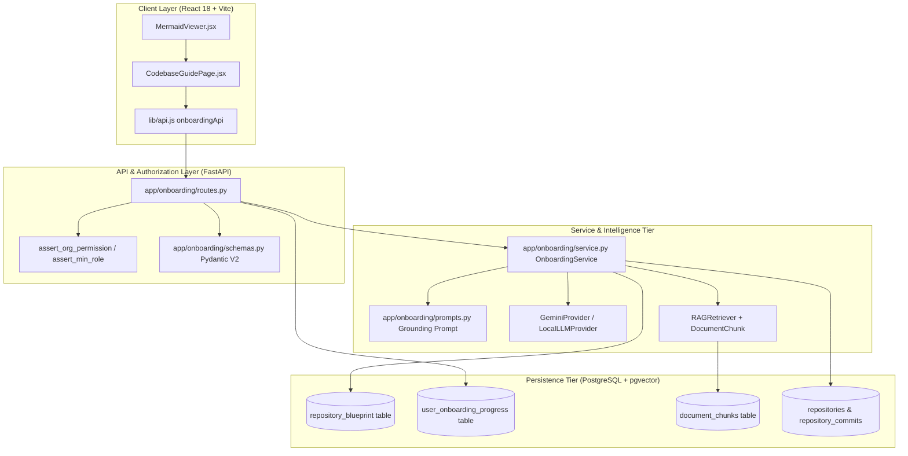
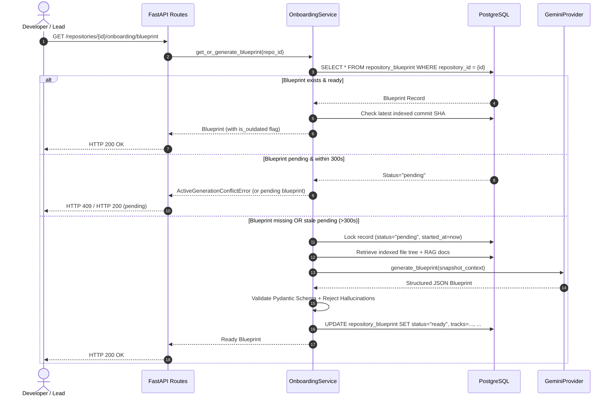
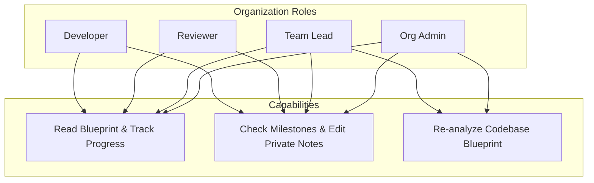
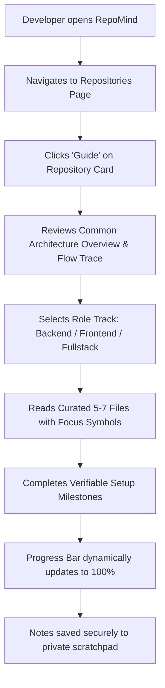
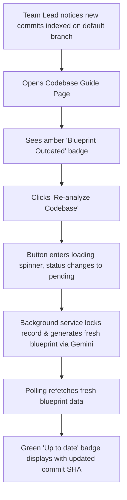

# RepoMind — Developer Onboarding & Codebase Blueprint Walkthrough

## 1. Feature Overview & Intended Users

### Overview
The **Developer Onboarding & Codebase Blueprint** is an engineering acceleration subsystem within RepoMind 2.0. When engineers join a software organization or rotate across repositories, understanding a complex codebase typically consumes weeks of ad-hoc questioning, tribal knowledge handoffs, and trial-and-error debugging.

RepoMind automates this ramp-up phase by generating a verified, grounded, and role-specialized architectural blueprint directly from the indexed repository snapshot in PostgreSQL. Unlike generic AI code explainers, RepoMind enforces strict grounding against actual files, validates syntax, isolates sensitive core systems from safe beginner areas, traces request-to-database execution flows, and guarantees complete anti-surveillance privacy for developers.

### Intended Users
1. **New Hires & Rotating Engineers (Developers):**
   - Consume a unified repository architecture overview.
   - Choose their role track (**Backend**, **Frontend**, or **Fullstack**) to receive a curated reading order of 5–7 files with line ranges and focus symbols.
   - Complete hands-on ramp-up milestones (environment validation, model inspection, healthcheck verification).
   - Maintain private, unmonitored developer notes in a local scratchpad.
2. **Reviewers & Senior Engineers:**
   - Use the architectural execution flow traces and subsystem breakdown to understand cross-boundary ripple effects during code reviews.
3. **Team Leads & Engineering Managers:**
   - Maintain architectural blueprint freshness across branch evolutions using role-gated manual re-analysis (`POST /repositories/{id}/onboarding/blueprint/refresh`).
   - Identify blast radius zones and maintain safe starter backlog areas for junior contributors.
   - *Strict Boundary:* Managers and leads never receive individual developer progress statistics, completion percentages, or private notes.

---

## 2. Complete System Architecture

RepoMind couples a FastAPI backend with PostgreSQL (pgvector storage), an asynchronous LLM provider tier, and a React 18 single-page application.



---

## 3. Database Schema & Migration Details

The module introduces two tables registered in Alembic revision `71a3ba5afa1e` (`add_onboarding_blueprint_and_progress`):

### 1. `repository_blueprint`
Stores the generated codebase architecture, tracks, blast radius zones, and flow traces per repository snapshot.
- `id` (`Integer`, Primary Key, autoincrement)
- `repository_id` (`Integer`, Foreign Key `repositories.id`, `ondelete="CASCADE"`, indexed, Unique constraint)
- `analyzed_commit_sha` (`String(40)`, Not Null): Commit SHA from which the blueprint was assembled.
- `status` (`String(20)`, Default `'pending'`, indexed): Concurrency state (`'pending'`, `'ready'`, `'failed'`).
- `generation_started_at` (`DateTime(timezone=True)`, Nullable): Generation lock timestamp.
- `generation_attempts` (`Integer`, Default `0`): Retry counter (max 3).
- `last_error` (`Text`, Nullable): Sanitized failure description.
- `architecture_pattern` (`String(100)`, Nullable): Architectural archetype (e.g. "Modular Monolith", "Microservices").
- `summary` (`Text`, Nullable): Plain-text architectural summary.
- `subsystems` (`JSONB`, Nullable): List of `{name, path, purpose, key_files}`.
- `request_flow` (`JSONB`, Nullable): List of `{step_number, layer, file, symbol, description}`.
- `tracks` (`JSONB`, Nullable): Map of `{backend: Track, frontend: Track, fullstack: Track}` with 5–7 reading order files and milestones.
- `caution_zones` (`JSONB`, Nullable): Sensitive directories with high blast radius.
- `safe_starter_areas` (`JSONB`, Nullable): Beginner-friendly areas and suggested starter issues.
- `mermaid_diagram` (`Text`, Nullable): Sanitized Mermaid flowchart source.
- `created_at` (`DateTime(timezone=True)`, Default `func.now()`)
- `updated_at` (`DateTime(timezone=True)`, Default `func.now()`, onupdate `func.now()`)

### 2. `user_onboarding_progress`
Stores personal, non-surveilled ramp-up progress per user per repository.
- `id` (`Integer`, Primary Key, autoincrement)
- `user_id` (`Integer`, Foreign Key `users.id`, `ondelete="CASCADE"`, indexed)
- `repository_id` (`Integer`, Foreign Key `repositories.id`, `ondelete="CASCADE"`, indexed)
- `active_track` (`String(20)`, Default `'backend'`)
- `completed_milestones` (`JSONB`, Default `[]`): Array of completed milestone IDs.
- `notes` (`Text`, Nullable): Private developer scratchpad.
- `created_at` / `updated_at` (`DateTime(timezone=True)`)
- **Unique Constraint:** `uq_user_repo_onboarding (user_id, repository_id)` prevents multi-row drift per user.

---

## 4. Blueprint Generation Lifecycle



---

## 5. Gemini Prompt & RAG Integration Design

### Snapshot Context Assembly
The blueprint generator never operates in a vacuum or invents repository structures. `OnboardingService._build_snapshot_context` queries the PostgreSQL database:
1. Validates that the repository has indexed documents in `document_chunks`.
2. Gathers distinct file paths from `document_chunks` for the commit.
3. Retrieves relevant code excerpts from framework entry points (`main.py`, `App.jsx`, `routes`, `auth`, `models`).
4. Structures context with repository name, commit SHA, file hierarchy, and code samples.

### Grounding System Prompt (`prompts.py`)
The prompt instructs the model:
- You are the Lead Architect for RepoMind.
- Work **exclusively** with files present in the indexed snapshot.
- Reject speculation: never invent files, classes, or API routes.
- Produce exactly three tracks: `backend`, `frontend`, and `fullstack`.
- Provide 5–7 prioritized reading order files per track with purpose, line ranges, and focus symbols.
- Define actionable, verifiable milestones (`run_command`, `code_inspection`, `first_task`).
- Output clean JSON conforming strictly to the Pydantic schema.

---

## 6. Snapshot & Commit SHA Handling

1. **Snapshot Pinning:** Each generated blueprint stores the exact 40-character `analyzed_commit_sha`.
2. **Staleness Distinction:**
   - The service compares `blueprint.analyzed_commit_sha` against `repository.default_branch_head_sha` or the latest indexed snapshot.
   - If the repository has new indexed commits since blueprint generation, `is_outdated` is computed as `True`.
   - The UI displays an amber badge: `Blueprint Outdated (New commits available)`.
3. **GET Idempotency:** Calling `GET` on an outdated blueprint does **not** trigger an unexpected background LLM call. It serves the current blueprint with `is_outdated=true`. Re-analysis requires an explicit `POST /refresh`.

---

## 7. Grounding & Anti-Hallucination Safeguards

To prevent AI hallucinations from polluting developer onboarding:
1. **Repository Path Allowlist:**
   - Before saving to the database, `OnboardingService._filter_grounded_paths` validates every generated file path against the set of indexed repository paths.
   - Any subsystem, request flow step, reading order entry, or caution zone referencing a fabricated file is pruned or corrected.
2. **Mermaid Syntax Validation:**
   - Generated diagrams must start with a recognized diagram keyword (`flowchart`, `graph`, `sequenceDiagram`, `classDiagram`, `stateDiagram`, `erDiagram`).
   - If the LLM generates syntax that fails Pydantic validation, the schema validator rejects it.
3. **Structured Pydantic Validation:**
   - Pydantic V2 strictly validates milestones, track names, action types (`run_command`, `code_inspection`, `first_task`, `architecture_reading`), and caution levels (`critical`, `high`, `moderate`).
   - Malformed payloads cannot be persisted.

---

## 8. Concurrency Locks & Stale-Job Recovery

### Atomic Database Locking
Generation concurrency is managed through the `status`, `generation_started_at`, and `generation_attempts` fields:
1. When generation starts, the status is atomically set to `'pending'` with `generation_started_at = func.now()`.
2. If another request attempts regeneration while a job is pending, an `ActiveGenerationConflictError` is raised, returning `HTTP 409 Conflict`.

### Stale Pending Recovery
If a generation worker crashes or times out:
- Any pending job with `generation_started_at > 300 seconds` is treated as **stale**.
- The service increments `generation_attempts`.
- If attempts $\le 3$, it clears the lock and retries generation safely.
- If attempts $> 3$, it sets status to `'failed'` and logs the exhaustion.

---

## 9. Cache Invalidation & Last-Known-Good Behavior

When an authorized Team Lead or Org Admin triggers `POST /repositories/{id}/onboarding/blueprint/refresh`:
- If regeneration fails (e.g. LLM API unavailable, rate limit exceeded, network drop):
  - The service captures the error in `last_error`.
  - **Crucial Invariant:** If a previously valid, ready blueprint existed, its architectural data, tracks, and reading orders are **preserved intact** so developers are not left with a broken screen. The status remains `'ready'` or recovers to the last-known-good state with a logged warning.

---

## 10. Complete API Reference

All onboarding endpoints are mounted under `/api/v1` and require cookie-based authentication.

### `GET /repositories/{repository_id}/onboarding/blueprint`
- **Permission:** `Permission.REPOS_READ` (`repositories.read`)
- **Description:** Returns the active codebase onboarding blueprint and staleness metadata.
- **Success Response (200 OK):**
```json
{
  "repository_id": 1,
  "analyzed_commit_sha": "a1b2c3d4e5f678901234567890abcdef12345678",
  "status": "ready",
  "is_outdated": false,
  "architecture_pattern": "Modular Monolith",
  "summary": "RepoMind is an engineering intelligence system...",
  "subsystems": [
    {
      "name": "API Layer",
      "path": "backend/app",
      "purpose": "FastAPI controllers and route handlers",
      "key_files": ["backend/app/main.py"]
    }
  ],
  "request_flow": [
    {
      "step_number": 1,
      "layer": "API Routing",
      "file": "backend/app/main.py",
      "symbol": "app",
      "description": "Dispatches incoming requests"
    }
  ],
  "tracks": {
    "backend": {
      "track_name": "backend",
      "reading_order": [
        {
          "file_path": "backend/app/main.py",
          "role": "Entry Point",
          "why_read": "Server bootstrap and middleware pipeline",
          "focus_symbols": ["app", "lifespan"],
          "key_lines": "L1-L60"
        }
      ],
      "milestones": [
        {
          "id": "be_m1",
          "title": "Run Unit Test Suite",
          "description": "Execute pytest locally",
          "action_type": "run_command",
          "action_hint": "pytest backend/tests/"
        }
      ]
    },
    "frontend": { "track_name": "frontend", "reading_order": [], "milestones": [] },
    "fullstack": { "track_name": "fullstack", "reading_order": [], "milestones": [] }
  },
  "caution_zones": [
    {
      "path": "backend/app/auth",
      "risk_level": "critical",
      "reason": "Token validation and cryptography"
    }
  ],
  "safe_starter_areas": [
    {
      "area": "Unit Test Suite",
      "description": "Independent tests safe for new engineers",
      "starter_ideas": ["Add edge case tests for utility helpers"]
    }
  ],
  "mermaid_diagram": "flowchart TD\n    A[Client] --> B[FastAPI]",
  "created_at": "2026-11-11T10:00:00Z",
  "updated_at": "2026-11-11T10:00:00Z"
}
```
- **Errors:** `400 Bad Request` (Unindexed repo), `401 Unauthorized`, `403 Forbidden` (No repo read permission), `404 Not Found`.

---

### `POST /repositories/{repository_id}/onboarding/blueprint/refresh`
- **Permission:** `Permission.REPOS_INDEX` AND Minimum Role: `team_lead` (or `org_admin`)
- **Description:** Forces regeneration of the blueprint from the latest indexed snapshot.
- **Success Response (200 OK):** Updated `BlueprintResponse` payload.
- **Errors:** `400 Bad Request` (Unindexed), `401 Unauthorized`, `403 Forbidden` (Developer/Reviewer role denied), `409 Conflict` (Active generation in flight).

---

### `GET /repositories/{repository_id}/onboarding/progress`
- **Permission:** Authentication & Repository Membership
- **Description:** Retrieves the calling developer's isolated onboarding progress.
- **Success Response (200 OK):**
```json
{
  "repository_id": 1,
  "active_track": "backend",
  "completed_milestones": ["be_m1"],
  "notes": "PostgreSQL port mapped to 5432 locally.",
  "updated_at": "2026-11-11T10:30:00Z"
}
```
- **Errors:** `401 Unauthorized`, `403 Forbidden` (Not an organization member).

---

### `PUT /repositories/{repository_id}/onboarding/progress`
- **Permission:** Authentication & Repository Membership
- **Description:** Updates the developer's track, milestones, or notes.
- **Request Body:**
```json
{
  "active_track": "backend",
  "completed_milestones": ["be_m1", "be_m2"],
  "notes": "All tests green."
}
```
- **Validation:** Milestone IDs are validated against track definitions in the active blueprint. Forged or unapproved milestone IDs return `422 Unprocessable Entity`.
- **Errors:** `401 Unauthorized`, `403 Forbidden`, `422 Unprocessable Entity`.

---

## 11. Role Hierarchy & Repository Authorization



| Role | `GET /blueprint` | `GET /progress` | `PUT /progress` | `POST /refresh` |
|---|:---:|:---:|:---:|:---:|
| **Developer** | ✅ | ✅ | ✅ | ❌ (`403 Forbidden`) |
| **Reviewer** | ✅ | ✅ | ✅ | ❌ (`403 Forbidden`) |
| **Team Lead** | ✅ | ✅ | ✅ | ✅ |
| **Org Admin** | ✅ | ✅ | ✅ | ✅ |
| **Non-member** | ❌ (`403`) | ❌ (`403`) | ❌ (`403`) | ❌ (`403`) |
| **Unauthenticated** | ❌ (`401`) | ❌ (`401`) | ❌ (`401`) | ❌ (`401`) |

---

## 12. Private Progress & Anti-Surveillance Guarantees

RepoMind explicitly rejects developer surveillance mechanisms:
1. **Isolated Progress Table:** `user_onboarding_progress` is keyed strictly by `(user_id, repository_id)`.
2. **Zero Aggregation APIs:** There are no organization-wide endpoints (e.g. `/analytics/onboarding-completion` or `/teams/{id}/onboarding-leaderboard`).
3. **No Manager Dashboards:** Team Leads and Admins cannot query or view another engineer's milestone checklist or scratchpad notes.
4. **No Evaluation Scoring:** Progress is treated exclusively as personal developer scaffolding.
5. **Clear UI Privacy Banner:** The Codebase Guide page features an immutable privacy notice informing engineers that their progress is strictly confidential.

---

## 13. Frontend Component & Routing Architecture

### Component Hierarchy
- [`src/App.jsx`](file:///c:/Users/harshita.baghel/Task/Learning/Al/RepoMind%20Project/repo/frontend/src/App.jsx): Defines `/repositories/:rid/guide` wrapped in `ProtectedRoute(Permissions.REPOS_READ)`.
- [`src/pages/RepositoriesPage.jsx`](file:///c:/Users/harshita.baghel/Task/Learning/Al/RepoMind%20Project/repo/frontend/src/pages/RepositoriesPage.jsx): Exposes a "Guide" button on repository cards.
- [`src/pages/CodebaseGuidePage.jsx`](file:///c:/Users/harshita.baghel/Task/Learning/Al/RepoMind%20Project/repo/frontend/src/pages/CodebaseGuidePage.jsx):
  - **Section 1 (Architecture Overview):** Pattern badge, summary, subsystems, request execution flow trace, and Mermaid diagram.
  - **Section 2 (Track Selector):** Tabs for `Backend`, `Frontend`, and `Fullstack`.
  - **Section 3 (Prioritized Reading Order):** 5–7 cards with file path, role, line ranges, rationale, and focus symbols.
  - **Section 4 (Milestones & Scratchpad):** Verifiable milestone checkboxes, real-time dynamic progress bar, and personal scratchpad with autosave (800ms debounce + blur trigger).
  - **Section 5 (Blast Radius Compass):** Caution Zones and Safe Starter Areas.
  - **Header Controls:** Freshness indicator, commit SHA pill, and "Re-analyze Codebase" button (conditioned on `isOrgAdmin || isTeamLead || isLead`).
- [`src/components/Onboarding/MermaidViewer.jsx`](file:///c:/Users/harshita.baghel/Task/Learning/Al/RepoMind%20Project/repo/frontend/src/components/Onboarding/MermaidViewer.jsx): Sandboxed visualizer for flowcharts and architectures.

---

## 14. Mermaid Rendering Security

1. **Strict Sandboxing:** `mermaid.initialize({ startOnLoad: false, securityLevel: 'strict', ... })` prevents arbitrary JavaScript injection or XSS execution within rendered SVGs.
2. **Unique DOM Anchors:** Uses deterministic IDs (`mermaid-svg-${uniqueId}`) avoiding collision or DOM pollution.
3. **Graceful Fallback:** If diagram syntax is invalid or rendering encounters an error, `MermaidViewer` catches the exception and renders a styled monospace code block containing the clean textual diagram definition without crashing the UI.

---

## 15. Developer Onboarding User Journey



---

## 16. Team Lead Refresh User Journey



---

## 17. Testing Commands & Actual Results

### Backend Pytest Suite
```powershell
.venv\Scripts\python.exe -m pytest backend/tests/ -v
```
**Output:**
```text
================ 110 passed, 28 warnings in 353.43s (0:05:53) =================
- test_onboarding_models.py: 3 passed
- test_onboarding_service.py: 10 passed
- test_onboarding_routes.py: 14 passed
- test_api_review.py: 6 passed
- test_approval_authorization.py: 8 passed
- test_github.py, test_github_auth.py: 12 passed
- test_rag.py, test_rag_retriever.py: 13 passed
- test_organization_isolation.py: 2 passed
- test_review.py: 28 passed
```

### Frontend Vitest Suite
```powershell
cd frontend; npx vitest run tests/CodebaseGuidePage.test.jsx
```
**Output:**
```text
 ✓ tests/CodebaseGuidePage.test.jsx (12 tests) 1277ms
   ✓ 1. Loads and renders common repository overview before tracks
   ✓ 2. Switches role tracks and updates curated reading list and milestones
   ✓ 3. Renders 5-7 reading order items with purpose and focus symbols
   ✓ 4. Toggles milestone completion and updates progress bar
   ✓ 5. Persists private developer notes
   ✓ 6. Preserves user edits when progress save fails
   ✓ 7. Displays Caution Zones and Safe Starter Areas with blast radius indicators
   ✓ 8. Shows refresh button for Team Lead+ and handles refresh
   ✓ 9. Hides refresh button for developers without REPOS_INDEX permission
   ✓ 10. Renders Outdated Blueprint badge when is_outdated is true
   ✓ 11. Renders Unindexed Repository error state when API returns 400
   ✓ 12. Falls back to textual representation when Mermaid diagram syntax is invalid

Test Files: 1 passed (1) | Tests: 12 passed (12)
```

### Frontend Lint & Production Build
```powershell
cd frontend; npm run lint
cd frontend; npm run build
```
**Output:**
```text
> eslint src --ext .js,.jsx,.ts,.tsx
✖ 4 problems (0 errors, 4 warnings)

> vite build
✓ 1843 modules transformed.
✓ built in 30.13s (0 errors)
```

---

## 18. Deployment & Migration Instructions

1. **Apply Database Migration:**
   ```powershell
   .venv\Scripts\alembic.exe upgrade head
   ```
   Ensures `repository_blueprint` and `user_onboarding_progress` tables and unique constraints exist.

2. **Build Frontend Bundle:**
   ```powershell
   cd frontend
   npm install
   npm run build
   ```
   Compiles assets into `backend/static/`.

3. **Start FastAPI Application:**
   ```powershell
   .venv\Scripts\uvicorn.exe backend.app.main:app --host 0.0.0.0 --port 8000
   ```

---

## 19. Environment Variables & Operational Dependencies

- `DATABASE_URL`: PostgreSQL connection string (must have pgvector extension enabled).
- `GEMINI_API_KEY`: API key for Google Gemini model generation.
- `LLM_PROVIDER`: Set to `'gemini'` for live cloud generation, or `'local'` for deterministic offline/testing operation.
- `JWT_SECRET_KEY`: Secret key for session cookie encryption.
- `GITHUB_CLIENT_ID` / `GITHUB_CLIENT_SECRET`: GitHub App credentials for webhook and repository sync.

---

## 20. Known Limitations & Future Improvements

### Current Limitations
1. **Repository Index Dependency:** Onboarding blueprints require the repository to be indexed into `document_chunks`. For newly added repositories awaiting indexing, the API returns a friendly `400 Bad Request` instructing the user to trigger indexing first.
2. **Synchronous LLM Invocation in Refresh:** The initial `POST /refresh` initiates an atomic pending state and completes inline within HTTP timeout limits (~15–20s for Gemini). For repositories exceeding 100,000 files, moving this to an explicit background task queue (e.g. Celery / ARQ) is recommended.

### Future Roadmap
1. **Interactive Architecture Drill-Down:** Clicking on any subsystem node in the Mermaid diagram to filter the file reading list.
2. **Automated CI Setup Verification:** Integrating GitHub Actions test run status into the first milestone verification checklist.
3. **Multi-Branch Blueprints:** Generating blueprint comparisons across long-lived release or feature branches.

